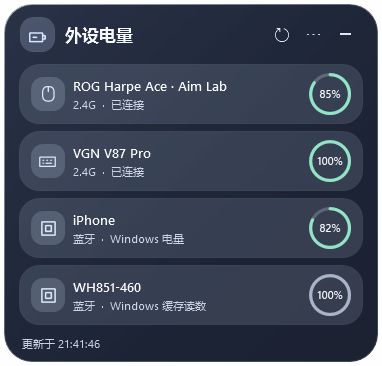

# 外设电量看板

在 Windows 桌面查看鼠标、键盘和蓝牙耳机等外设的电量，支持低电量提醒。



## 下载与运行

下载 [BatteryWidget.exe](运行版/BatteryWidget.exe)，保存到本地文件夹后双击运行。首次启动时，卡片出现在屏幕右下角。此版本适用于 Windows x64，需要 .NET 8 Desktop Runtime。

- 卡片用磨砂玻璃背景和圆环显示电量，充电时圆环呈蓝色。支持桌面捕捉的 Windows 会定期更新玻璃背景。
- 拖动顶部移动卡片。鼠标移到任意边或角出现双箭头后，按住拖动即可调整大小。
- 右键卡片 → **设置…** 会打开独立窗口。不透明度可拖滑条或直接输入 20–100，也可调整宽度、自动刷新间隔、置顶、开机启动和低电量通知。滑条和数字实时预览，点「保存」后记住设置。
- 右键设备行可改名、调整顺序或设置断开后仍显示。用「从卡片移除」停止显示该设备，之后可用右键菜单的「添加设备」恢复。设置窗口也可批量勾选想显示的设备。
- 最小化按钮将卡片收起到系统托盘。点击托盘图标可重新显示，右键托盘可退出。
- 默认每分钟刷新，也可以点击卡片右上角的刷新按钮。设备休眠后，可唤醒外设再刷新。灰色电量表示上次读数或 Windows 缓存。

## 实机适配

| 设备 | 本机验证 |
| --- | --- |
| ROG Harpe Ace Aim Lab Edition | 通过 2.4G ROG OMNI 接收器发送电量查询，读到 85% |
| VGN V87 Pro | 通过 2.4G 接收器发送电量查询，读到 100%。接收器在 Windows 中报告为 VXE V87 2.4G Dongle |
| 蓝牙设备 | 支持读取 Windows 提供的电量，并尝试标准低功耗蓝牙电量服务。设备提供可识别的分项数据时，会分别显示左耳、右耳或充电仓 |

两款外设的 USB 有线和蓝牙模式已预留读取路径，当前实机验证使用 2.4G。

## 从源码构建

```powershell
dotnet publish -c Release -r win-x64 --no-self-contained -p:PublishSingleFile=true -p:EnableSingleFileAnalyzer=false -o 运行版
```

使用 `--diagnose diagnostics.txt` 参数可以读取一轮设备状态并写入报告。
